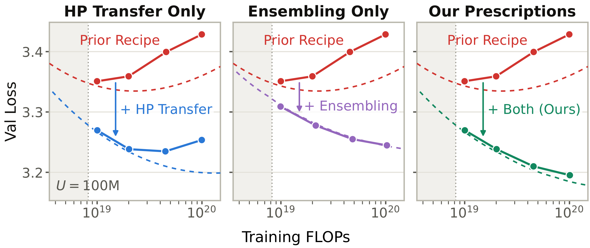

# Improving Data-Constrained Scaling with Hyperparameter Transfer and Ensembling

[Ethan Baron](https://baronet2.github.io/), [Shmuel Berman](https://shmuelberman.com/), [Anirudh Satheesh](https://anirudhsatheesh.com/), [Akshay Vegesna](https://www.akshayvegesna.com/), [Samip Dahal](https://x.com/industriaalist), [Andrew Gordon Wilson](https://cims.nyu.edu/~andrewgw/)

Paper: https://arxiv.org/abs/2610.XXXXX



## Abstract

As growing compute budgets outpace the growth of high-quality training data, large language models must be trained with both compute and data constraints in mind. Unfortunately, existing prescriptions for data-constrained scaling suffer from two important limitations.

First, whereas optimal hyperparameters vary wildly with model size and number of epochs, past works hold key hyperparameters such as weight decay fixed with scale. Second, past works neglect ensembling, a promising axis for scaling under data constraints.

We address both limitations, leading to improved prescriptions for scaling data-constrained training pipelines. Our method prescribes how to scale key hyperparameters and allocate compute to epochs, model parameters, and ensemble members. Controlling for training corpus size and compute budgets, our prescriptions achieve significantly lower validation loss than existing baselines, and this gap grows at larger scales.

## Citation

Please cite our paper as follows:

```bib
@article{baron2026dataconstrained,
  title         = {Improving Data-Constrained Scaling with Hyperparameter Transfer and Ensembling},
  author        = {Baron, Ethan and Berman, Shmuel and Satheesh, Anirudh and Vegesna, Akshay and Dahal, Samip and Wilson, Andrew Gordon},
  journal       = {arXiv preprint arXiv:2610.XXXXX},
  eprint        = {2610.XXXXX},
  archivePrefix = {arXiv},
  primaryClass  = {cs.LG},
  year          = {2026},
  month         = {oct},
  url           = {https://arxiv.org/abs/2610.XXXXX}
}
```

## Usage

### Environment

```bash
pip install -r requirements.txt
```

Training uses a single GPU. Default batch sizes fit an 80GB H100; lower them with `--device-batch-size` if needed.

### Preparing Data

```bash
python prepare_data.py
```

### Training Models

To train a model of size $N$, first figure out the corresponding depth $d$ for our scaling ladder:

| $d$ | $N$ |
|---|---|
| 6 | 30M |
| 8 | 51M |
| 11 | 101M |
| 15 | 214M |
| 19 | 398M |

To train a model of depth $d$ on a dataset of $U$ million tokens for $R$ epochs, use:

```bash
python train.py -U 100 -d 11 -R 8
```

If you wish to train an ensemble of models, use this to train multiple seeds:

```bash
python train.py -U 100 -d 11 -R 8 -s 0,1,2,3
```

By default, the effective learning rate and weight decay come from our hyperparameter scaling law. If you wish to specify them, use this:

```bash
python train.py -U 100 -d 11 -R 8 -elr 0.1 -wd 0.1
```

### Scoring Models and Ensembles

`train.py` saves outputs to `runs/` and records each run in `runs.csv`. To score a model or ensemble of models, use:

```bash
python score.py -U 100 -d 11 -R 8 -M 4
```

This script will grab seeds (0, 1, ..., M-1) for the corresponding ($U$, $d$, $R$, eLR, WD), compute the scores for various ensemble strategies on the calibration set, and record the performance of the chosen strategy on the validation set in `scores.csv`.

### Fitting Scaling Law

To fit a scaling law, make a CSV with one row per ($U$, $d$, $R$, $M$) and run:
```bash
python fit_scaling_law.py scores.csv
```
